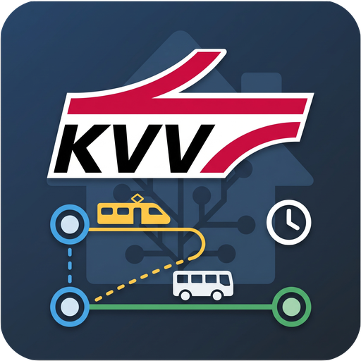

<p align="center">
  
</p>

# KVV Departures for Home Assistant

A native Home Assistant integration (HACS compatible) that shows live departures,
delays and cancellations for any stop in the network of the Karlsruher
Verkehrsverbund (KVV), as regular sensors. No iframe and no add-on required.

The UI follows each user's display language. German and English are included;
Home Assistant picks the translation per user, so every household member sees
the setup dialogs and entity names in their own language.

## Installation

**HACS (recommended)**

1. HACS → ⋮ → *Custom repositories* → add `https://github.com/Kaphalor/ha-kvv-departures` as type *Integration*.
2. Install *KVV Departures* and restart Home Assistant.

**Manual**

1. Copy `custom_components/kvv_departures` to `<config>/custom_components/`.
2. Restart Home Assistant.

Then go to *Settings → Devices & services → Add integration → KVV Departures*,
search for a stop and select it. Add the integration again for each additional stop.

Settings (gear icon on the entry): number of departures, line filter, walking
time in minutes, update interval and data source.

## Entities per stop

| Entity | Content |
|---|---|
| Next departure | Timestamp of the next departure (actual time). The attribute `departures` holds the complete list; this is the entity the departure board card uses. |
| Delay of next departure | Delay in minutes. |
| Departure 1 … N | One entity per departure. Attributes: `line`, `direction`, `platform`, `stop`, `operator`, `color`, `text_color`, `delay`, `planned_time`, `time`, `cancelled`, `infos`, `text`. |

Entity IDs are generated from the entity names in Home Assistant's system
language when the entity is first created, for example
`sensor.durlacher_tor_next_departure` (English) or
`sensor.durlacher_tor_nachste_abfahrt` (German). Check the exact IDs under
*Devices & services → KVV Departures*.

## Departure board card

The integration ships a Lovelace card that looks like a station departure board.
It is registered automatically, so no dashboard resource has to be added.

- Line badges use the **official KVV line colors** (taken from the KVV GTFS feed, CC0).
- Shows the actual time, the struck-through scheduled time, the delay (amber/red) and a live countdown.
- Cancelled departures are struck through.
- **Click a departure** for details: status, platform, stop, transport type, operator and
  KVV notices (e.g. construction work) with links. "Show entity" opens the sensor's more-info dialog.
- Follows the user's display language (German and English) and has a visual editor.

Add it via *Edit dashboard → Add card → KVV Departures*, or in YAML:

```yaml
type: custom:kvv-departures-card
entity: sensor.durlacher_tor_next_departure
title: Durlacher Tor        # optional, defaults to the stop name
max_departures: 6           # optional
board: true                 # dark board style; false follows your theme
show_platform: true
```

If the card does not show up after an update, reload the browser page (Ctrl+F5).

### Other cards

**Markdown card** with delays:

```yaml
type: markdown
title: Durlacher Tor
content: >
  
  
  **{{ d.line }}** {{ d.direction }} – **{{ d.time }}**
   ❌ cancelled
   (+{{ d.delay }} min, scheduled {{ d.planned_time }})
  

  
```

The text inside a card template is your own, so write it in whichever
language you like.

**Entities card** using the single-departure sensors:

```yaml
type: entities
entities:
  - entity: sensor.durlacher_tor_departure_1
    secondary_info: attribute
    attribute: text
  - entity: sensor.durlacher_tor_departure_2
  - entity: sensor.durlacher_tor_departure_3
```

## Data sources

| Source | Status |
|---|---|
| `efa` (default) | Unofficial EFA interface at `projekte.kvv-efa.de`. No registration, real-time data. Undocumented and may change without notice. |
| `trias` | Official [KVV open data interface](https://www.kvv.de/fahrplan/fahrplaene/open-data.html) (VDV 431-2). Access requires a usage agreement; contact fahrplan@kvv.karlsruhe.de. |

To use TRIAS, set the source to `trias` in the settings and enter the URL and
requestor reference you receive from KVV. Stop search always uses EFA.

**The TRIAS client has only been tested against a hand-written sample response,
not against the real server.** Expect small adjustments (authentication,
namespaces, stop IDs) once you have real credentials.

## Status

The API layer is covered by automated tests, including live requests to KVV. The
departure board card is tested in headless Chrome against a mocked `hass` object
(rendering, line colors, dialog, languages). The Home Assistant parts (config flow,
sensors, card registration) have been syntax-checked but not yet run in a real
Home Assistant instance.

## Development

```
python -m venv venv && venv/bin/pip install aiohttp pytest pytest-asyncio
venv/bin/pytest tests

# card test (needs Chrome/Chromium)
npm i --no-save playwright-core
CHROME=/path/to/chrome node tests/card/card.test.mjs
```

Line colors come from the official KVV GTFS feed. To refresh them:

```
curl -o google_transit.zip https://projekte.kvv-efa.de/GTFS/google_transit.zip
python3 scripts/generate_line_colors.py google_transit.zip
```

Translations live in `custom_components/kvv_departures/translations/`. To add a
language, copy `en.json` to `<language code>.json` and translate the values;
`tests/test_translations.py` checks that all languages have the same keys.

## Disclaimer

This is an unofficial project and is not affiliated with the KVV. The KVV name
and logo shown in the icon belong to their respective owners.
